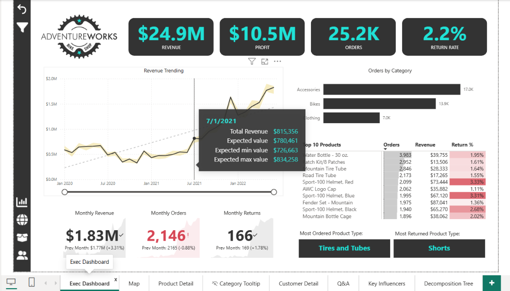
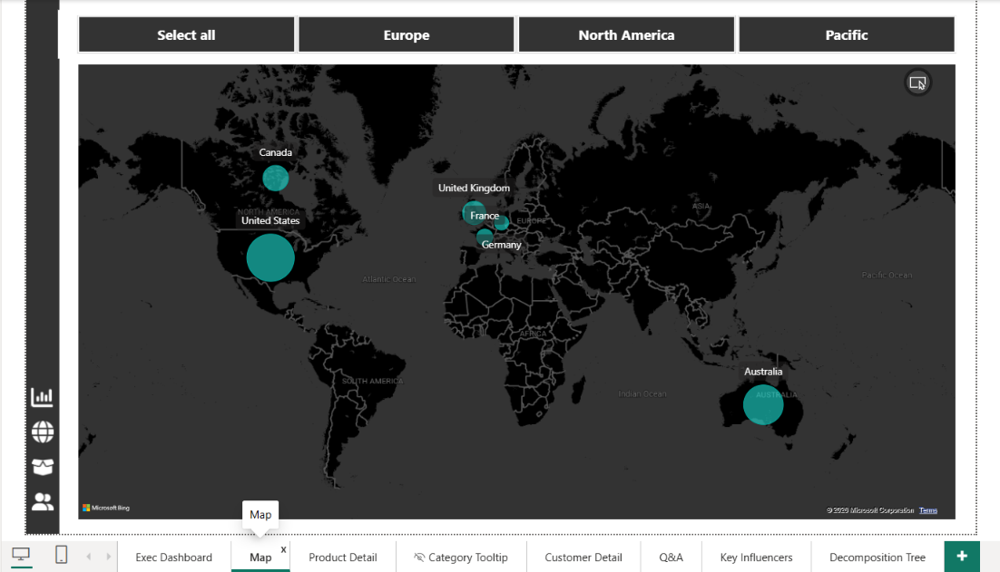
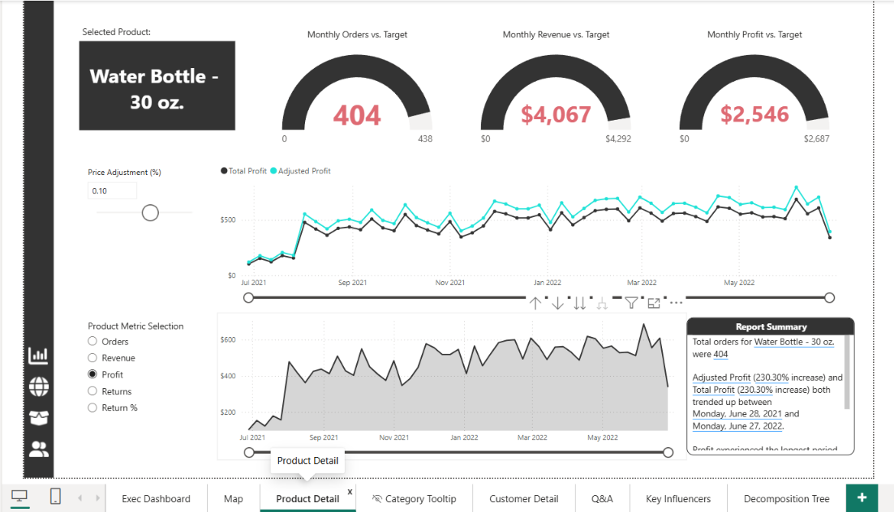
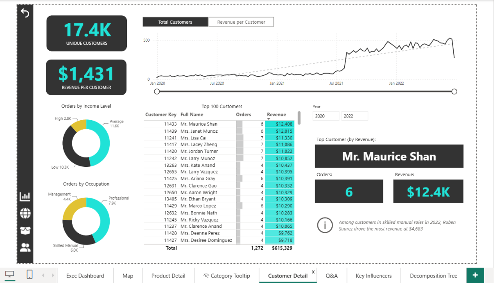
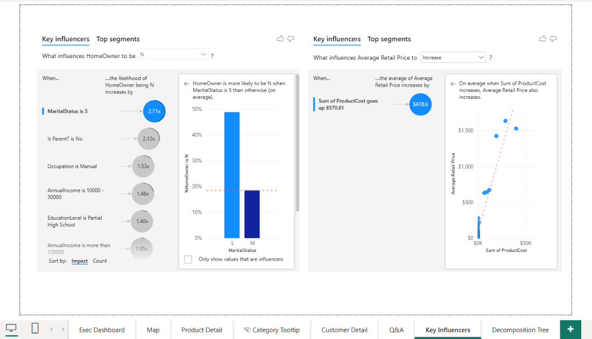
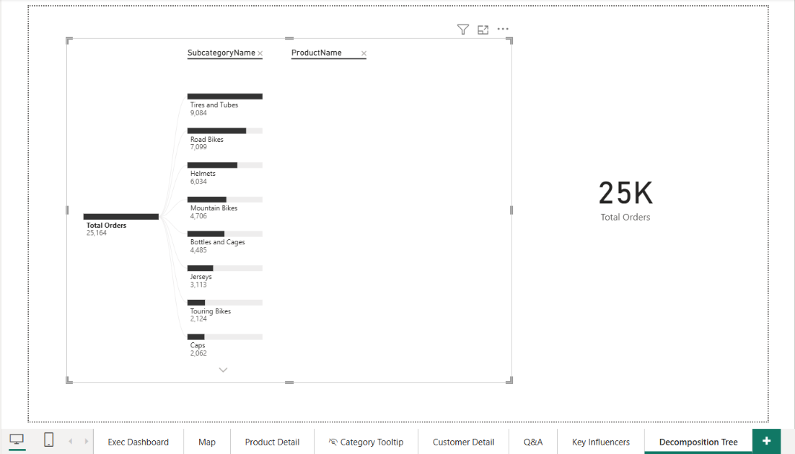
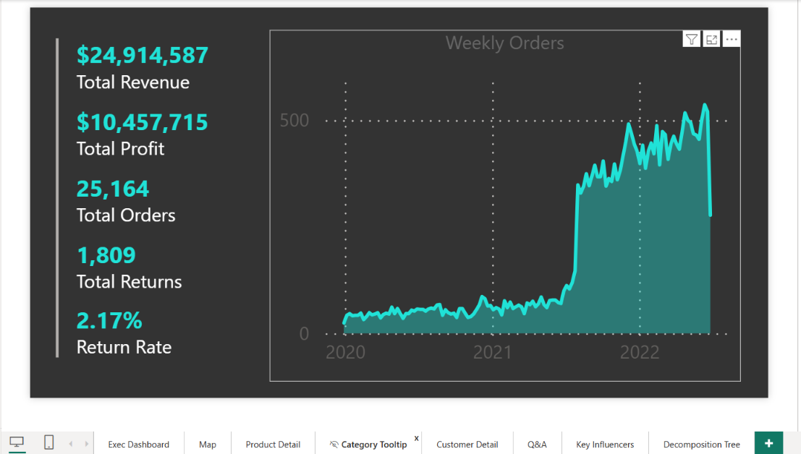

# AdventureWorks Retail Analytics Report (Power BI)

An 8-page Power BI report for a fictional bike retailer. It answers the questions an executive asks first: how are revenue, profit, orders and returns trending, which products and regions drive them, who the best customers are, and what happens if prices change.

## Headline numbers (Jan 2020 to mid 2022)

| Metric | Value |
|---|---|
| Revenue | $24.9M |
| Profit | $10.5M |
| Orders | 25,164 |
| Returns | 1,809 (2.17% return rate) |
| Unique customers | 17.4K ($1,431 revenue per customer) |

## What the report answers

| Page | Question | Key features |
|---|---|---|
| Executive Dashboard | How is the business doing right now? | KPI cards, revenue trend with an expected-range band, month-over-month cards with prior-month comparison, top 10 products by orders with return rate, most ordered and most returned product type |
| Map | Where do sales come from? | Bubble map by country with region buttons (Europe, North America, Pacific) |
| Product Detail | How is one product doing against target, and what if we change the price? | Orders, revenue and profit gauges against target, price-adjustment parameter (what-if), metric selector, auto-generated summary text |
| KPI Tooltip | Quick context on hover | Custom tooltip page with totals and weekly orders |
| Customer Detail | Who are our customers? | Orders by income level and occupation, top 100 customers, top customer card, year filter |
| Key Influencers | What drives homeownership and product price? | Key Influencers analysis on customer and product attributes |
| Decomposition Tree | Where do orders come from? | Drill from total orders to category, subcategory and product |

## Data model

A star schema: one sales fact table with six lookup tables (calendar, customer, product, product category, product subcategory, territory), plus a dedicated measures table and parameter tables for the what-if price slider and metric selection.

DAX measures include: Total Revenue, Total Profit, Total Orders, Total Returns, Return Rate, Total Customers, Average Revenue per Customer, previous-month revenue/orders/returns, and revenue/profit/order target gaps.

## A few things the data shows

- Accessories drive the most orders (17.0K), followed by Bikes (13.9K) and Clothing (7.0K); Tires and Tubes is the top subcategory (9,084 orders).
- Return rates are concentrated: the two Sport-100 helmet variants sit above 3% against a 2.17% overall rate, and Shorts is the most returned product type.
- Single customers are more likely to be non-homeowners (2.71x) according to the Key Influencers view.
- Weekly orders step up sharply in mid 2021. This is a pattern in the sample dataset, not a data error. The final week of the series is incomplete, so the last point on the trend line is not a real drop.

## My additions

> Fill in before publishing: 2 or 3 findings or design choices that are your own (for example, a question you chose to investigate and what you found). Delete this box if there are none.

## How to open it

1. Download `report/AdventureWorks_Report_FINAL.pbix`.
2. Open it in Power BI Desktop (free, Windows).

## Screenshots

| | |
|---|---|
|  |  |
|  |  |
|  |  |

## About this project

Built in Power BI Desktop using Microsoft's AdventureWorks sample dataset while working through a guided Power BI course ([course name: fill in]). The report, model and DAX are mine to explain; the dataset is a public sample and the data is fictional.

## Author

Shravani Kulkarni, M.S. Data Science, Analytics and Engineering, Arizona State University. [LinkedIn](https://www.linkedin.com/in/shravani-kulkarni2003) | [GitHub](https://github.com/shravanii15)
